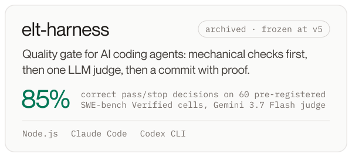
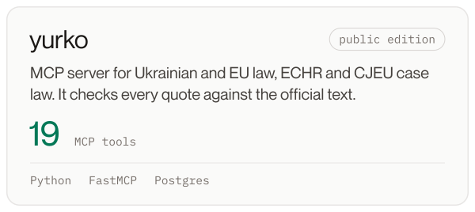
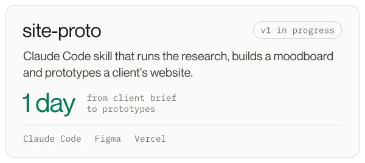
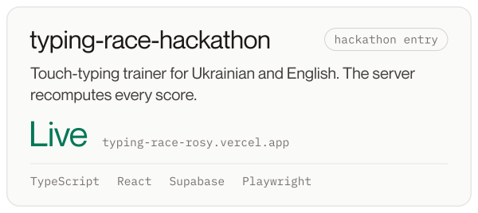

<picture>
<source media="(prefers-color-scheme: dark)" srcset="assets/banner-dark.svg">
<source media="(prefers-color-scheme: light)" srcset="assets/banner-light.svg">

</picture>

I'm an AI engineer working forward-deployed: I sit with the teams who use the software, find what slows them down, then build and run LLM systems and automations that take that work over. Coding agents write most of my code; I review their work and own the specs, tests and CI gates that decide what gets merged. I'm in Batumi, Georgia, working remotely and open to full-time or contract roles.

<a href="https://github.com/prodelt/elt-harness"><picture><source media="(prefers-color-scheme: dark)" srcset="assets/card-elt-harness-dark.svg"><source media="(prefers-color-scheme: light)" srcset="assets/card-elt-harness-light.svg"></picture></a>
<a href="https://github.com/prodelt/yurko"><picture><source media="(prefers-color-scheme: dark)" srcset="assets/card-yurko-dark.svg"><source media="(prefers-color-scheme: light)" srcset="assets/card-yurko-light.svg"></picture></a>
<a href="https://github.com/prodelt/site-proto"><picture><source media="(prefers-color-scheme: dark)" srcset="assets/card-site-proto-dark.svg"><source media="(prefers-color-scheme: light)" srcset="assets/card-site-proto-light.svg"></picture></a>
<a href="https://github.com/prodelt/typing-race-hackathon"><picture><source media="(prefers-color-scheme: dark)" srcset="assets/card-typing-race-hackathon-dark.svg"><source media="(prefers-color-scheme: light)" srcset="assets/card-typing-race-hackathon-light.svg"></picture></a>

[Website](https://mikhaylo-portfolio.vercel.app/en) &emsp; [LinkedIn](https://www.linkedin.com/in/mykhailo-stoliarenko-a1a937296) &emsp; [Email](mailto:stoliarenko.my@gmail.com)
